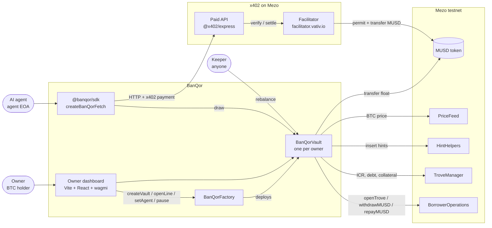
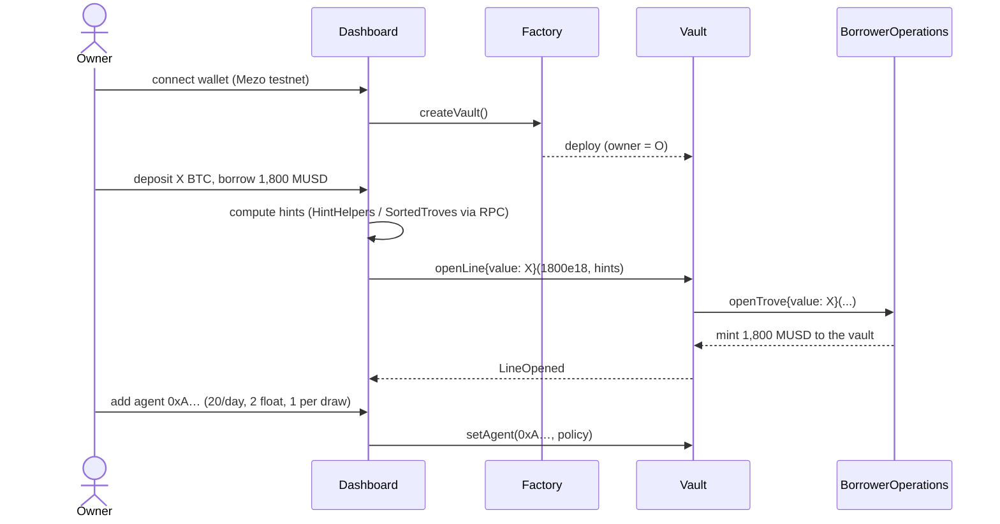
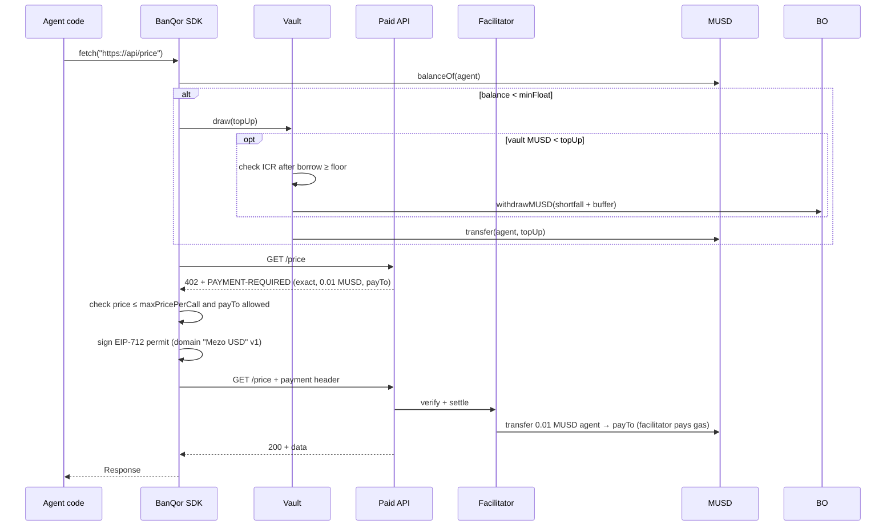
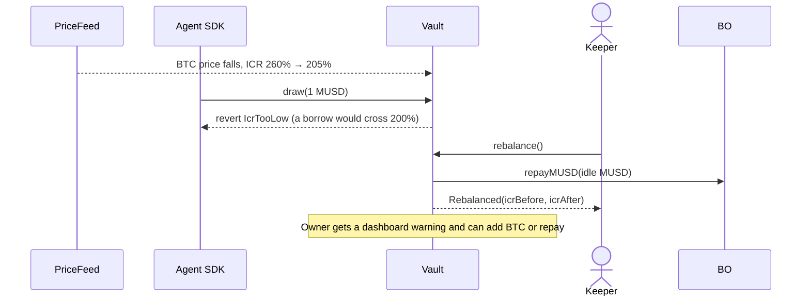

# BanQor: architecture

This document covers the technical design of BanQor: its components, contracts, flows, security model and configuration. For the product view, see [OVERVIEW.md](OVERVIEW.md) and [PRD.md](PRD.md).

---

## 1. System context



**Design principles**
1. **Extend Mezo, don't fork it.** Use Mezo's own trove contracts for credit and the official x402 facilitator and SDKs for payments. BanQor only adds the policy layer between them.
2. **Agents hold floats, never the line.** An agent's key can only pull small, capped amounts. Collateral and debt management are owner-only.
3. **Health first.** No borrow that would breach the owner's ICR floor can ever succeed.
4. **No new trust assumptions.** There's no BanQor server in the payment path. The demo API and dashboard are optional surfaces.

---

## 2. Repository layout

```
banqor/
├── contracts/                    Foundry project
│   ├── foundry.toml              solc 0.8.28, evm_version = "london"
│   ├── src/
│   │   ├── BanQorFactory.sol
│   │   ├── BanQorVault.sol
│   │   └── interfaces/
│   │       ├── IBorrowerOperations.sol
│   │       ├── ITroveManager.sol
│   │       ├── IHintHelpers.sol
│   │       ├── ISortedTroves.sol
│   │       └── IPriceFeed.sol
│   ├── test/
│   │   ├── BanQorVault.t.sol          unit (mock Mezo contracts)
│   │   ├── BanQorVault.fuzz.t.sol     fuzz + invariants
│   │   ├── BanQorFork.t.sol           fork of Mezo testnet
│   │   └── mocks/                        MockBorrowerOperations, MockTroveManager, MockMUSD ...
│   └── script/Deploy.s.sol
├── packages/sdk/                 @banqor/sdk (TypeScript, viem)
│   └── src/{index.ts, fetch.ts, vault.ts, errors.ts, abi.ts, config.ts}
├── apps/
│   ├── api/                      demo x402 API (Express + @x402/express)
│   ├── agent/                    setup.ts, run.ts, breach.ts
│   └── dashboard/                Vite + React + wagmi + viem
├── deployments/31611.json        single source of addresses
└── docs/                         OVERVIEW, PRD, ARCHITECTURE, PLAN
```

Tooling: pnpm workspaces, Foundry, TypeScript 5, viem 2, wagmi 2, `@x402/*@2.16.0`.

---

## 3. Smart contracts

### 3.1 External Mezo contracts (testnet)

| Contract | Address | Used for |
|---|---|---|
| MUSD | `0x118917a40FAF1CD7a13dB0Ef56C86De7973Ac503` | Float transfers, repay approvals |
| BorrowerOperations | `0xCdF7028ceAB81fA0C6971208e83fa7872994beE5` | `openTrove`, `withdrawMUSD`, `repayMUSD`, `addColl`, `withdrawColl`, `closeTrove` |
| TroveManager | `0xE47c80e8c23f6B4A1aE41c34837a0599D5D16bb0` | Trove debt, collateral, current ICR |
| HintHelpers | `0x4e4cBA3779d56386ED43631b4dCD6d8EacEcBCF6` | Sorted-list insert hints |
| SortedTroves | `0x722E4D24FD6Ff8b0AC679450F3D91294607268fA` | `findInsertPosition` for hints |
| PriceFeed | `0x86bCF0841622a5dAC14A313a15f96A95421b9366` | BTC/USD price |

> **To confirm on day 1 (fork test):** exact function signatures, return shapes (for example `getEntireDebtAndColl`, `getCurrentICR`), gas-compensation rules and the minimum net debt (1,800 MUSD per Mezo docs). The interfaces in `src/interfaces/` are written from the deployed ABIs, not assumed.

### 3.2 `BanQorFactory`

```solidity
function createVault() external returns (address vault);   // one per owner
function vaultOf(address owner) external view returns (address);
event VaultCreated(address indexed owner, address vault);
```

The factory stores the Mezo addresses once and passes them to each vault's constructor. A plain `new BanQorVault(...)` is enough for Wave 1, since gas on testnet doesn't matter. Clones are an option in Wave 2.

### 3.3 `BanQorVault`: state

```solidity
struct Policy {
    uint128 dailyCap;       // MUSD (18 dp) per 24h window
    uint128 maxFloat;       // max MUSD the agent may hold after a draw
    uint128 maxDrawPerTx;   // max single draw
    uint64  expiry;         // unix seconds; 0 = never
    bool    active;
}

struct AgentState {
    Policy  policy;
    uint128 spentInWindow;
    uint64  windowStart;
}

address public immutable owner;
bool    public paused;
bool    public lineOpen;
uint16  public icrFloorBps;          // default 20000 = 200%
uint16  public constant MIN_FLOOR_BPS = 15000;   // owner can't set below 150%
uint128 public borrowBuffer;         // extra MUSD borrowed per top-up to avoid tiny borrows
mapping(address => AgentState) public agents;
```

### 3.4 `BanQorVault`: functions

| Function | Caller | Behavior |
|---|---|---|
| `openLine(uint256 debt, address upperHint, address lowerHint)` payable | owner | Requires `!lineOpen`. Calls `BorrowerOperations.openTrove{value: msg.value}(...)` with the vault as borrower, so MUSD lands in the vault. Checks ICR ≥ floor afterwards |
| `addCollateral(hints)` payable | owner | `addColl` |
| `withdrawCollateral(amount, hints)` | owner | `withdrawColl`, then checks ICR ≥ floor. Sends BTC to the owner |
| `repay(amount, hints)` | owner | `repayMUSD` using the vault's MUSD |
| `closeLine()` | owner | `closeTrove` (the vault must hold enough MUSD; the owner tops up first). Sends BTC to the owner |
| `sweep(address to, uint256 amount)` | owner | Moves idle MUSD out of the vault |
| `setAgent(address agent, Policy p)` | owner | Creates or updates a policy. Keeps the current window state |
| `revokeAgent(address agent)` | owner | `active = false` |
| `setIcrFloor(uint16 bps)` | owner | `bps ≥ MIN_FLOOR_BPS` |
| `pause()` / `unpause()` | owner | Kill switch for `draw` |
| `draw(uint256 amount)` | agent | See 3.5 |
| `rebalance(hints)` | anyone | If ICR < floor + `REBALANCE_BUFFER_BPS`, repays debt with idle MUSD (debt stays at or above the protocol minimum) |
| `lineStatus()` view | anyone | `(coll, debt, icrBps, price, vaultFloat, paused, icrFloorBps)` |
| `agentStatus(address)` view | anyone | `(policy, spentInWindow, windowResetsAt, agentBalance, drawableNow)` |

All state-changing functions are `nonReentrant`. The vault has `receive()` so it can accept BTC returned by `withdrawColl` and `closeTrove`.

### 3.5 `draw()` logic

```text
draw(amount):
  require !paused                                   else Paused
  s = agents[msg.sender]
  require s.policy.active                           else AgentInactive / NotAgent
  require expiry == 0 || now < expiry               else AgentExpired
  require amount <= maxDrawPerTx                    else DrawTooLarge
  if now >= s.windowStart + 1 days:
      s.windowStart = now; s.spentInWindow = 0
  require s.spentInWindow + amount <= dailyCap      else DailyCapExceeded
  require MUSD.balanceOf(agent) + amount <= maxFloat else FloatExceeded

  s.spentInWindow += amount                         // effects before interactions

  shortfall = amount - min(amount, MUSD.balanceOf(vault))
  if shortfall > 0:
      borrowAmt = shortfall + borrowBuffer
      require icrAfterBorrow(borrowAmt) >= icrFloor else IcrTooLow
      BorrowerOperations.withdrawMUSD(borrowAmt, hints)   // MUSD minted to the vault
      emit Borrowed(borrowAmt)

  // even with no borrow, refuse draws while the trove is already below the floor
  require currentIcr() >= icrFloor                  else IcrTooLow
  MUSD.safeTransfer(agent, amount)
  emit Drawn(agent, amount, shortfall > 0 ? borrowAmt : 0)
```

`icrAfterBorrow(x) = coll * price / (debt + x + fee(x))`. The fee comes from the protocol's borrowing-fee view if one exists, otherwise from a conservative constant. Hints for `withdrawMUSD` are computed on-chain through `HintHelpers.getApproxHint` + `SortedTroves.findInsertPosition`. That costs more gas but keeps agents simple. In Wave 2 the SDK can pass hints off-chain.

### 3.6 Events and errors

```solidity
event LineOpened(uint256 coll, uint256 debt);
event AgentSet(address indexed agent, Policy policy);
event AgentRevoked(address indexed agent);
event Drawn(address indexed agent, uint256 amount, uint256 borrowed);
event Borrowed(uint256 amount);
event Repaid(uint256 amount);
event CollateralAdded(uint256 amount);
event CollateralWithdrawn(uint256 amount);
event Paused(); event Unpaused();
event Rebalanced(uint256 repaid, uint256 icrBefore, uint256 icrAfter);
event IcrFloorSet(uint16 bps);

error NotOwner(); error NotAgent(); error Paused(); error AgentInactive(); error AgentExpired();
error DrawTooLarge(); error DailyCapExceeded(); error FloatExceeded(); error IcrTooLow();
error LineNotOpen(); error LineAlreadyOpen(); error FloorTooLow(); error NothingToRebalance();
```

(The `Paused` event and error share a name. In code they'll be `VaultPaused` / `ErrPaused` to avoid the clash.)

---

## 4. Core flows

### 4.1 Open a line and register an agent



### 4.2 An agent pays for an API call (the main loop)



When the agent already has float, a call costs **no on-chain transaction from the agent**. Only the facilitator settles, and it pays the gas.

### 4.3 BTC price drops (health guard)



### 4.4 Kill switch

The owner clicks **Pause** in the dashboard, which calls `vault.pause()`. From then on every `draw` reverts with `Paused`. Agents can still spend whatever float they already hold, which is capped by `maxFloat`. That float is the worst-case loss.

---

## 5. Agent SDK: `@banqor/sdk`

```ts
import { createBanQorFetch } from "@banqor/sdk";

const fetchPaid = createBanQorFetch({
  agentKey: process.env.AGENT_KEY as `0x${string}`,
  vault: "0xVault…",
  network: "eip155:31611",
  minFloat: "0.20",           // MUSD: draw when below this
  topUp: "1.00",              // MUSD per draw (≤ policy.maxDrawPerTx)
  maxPricePerCall: "0.10",    // refuse anything pricier
  allowedPayees: ["0xApi…"],  // optional
  onEvent: (e) => console.log(e),
});

const res = await fetchPaid("http://localhost:4021/price");
```

**Internals**
- `vault.ts`: viem public and wallet clients, `ensureFloat()` (balance check, then `draw`, then wait for the receipt), and `getLineStatus()` / `getAgentStatus()`.
- `fetch.ts`: builds an `x402Client` with the `exact` EVM client scheme (`toClientEvmSigner(account)`) and wraps it with `wrapFetchWithPayment`. Before payment it runs a policy hook (max price, allowlist), and before each request it calls `ensureFloat()`.
- `errors.ts`: decodes vault custom errors through `decodeErrorResult` into `BanQorError { code: "DailyCapExceeded" | … }`.
- A simple in-process lock stops two concurrent requests from both triggering a draw.

---

## 6. Demo x402 API (`apps/api`)

This follows the official Mezo quickstart pattern:

```ts
const facilitator = new HTTPFacilitatorClient({ url: "https://facilitator.vativ.io" });
const server = new x402ResourceServer(facilitator).register("eip155:31611", new ExactEvmScheme());
app.use(paymentMiddleware({
  "GET /price":     { accepts: { scheme: "exact", price: "$0.01", network: "eip155:31611", payTo } },
  "GET /funding":   { accepts: { scheme: "exact", price: "$0.02", network: "eip155:31611", payTo } },
  "GET /sentiment": { accepts: { scheme: "exact", price: "$0.05", network: "eip155:31611", payTo } },
}, server));
```

Data comes from a public BTC market source, with a 60-second cache and a static fallback.

---

## 7. Owner dashboard (`apps/dashboard`)

| Area | Data source | Actions |
|---|---|---|
| Connect / network guard | wagmi `injected` connector, chain `31611` | Switch network |
| Create and open line | `factory.vaultOf(owner)`. Hints computed client-side via HintHelpers/SortedTroves reads | `createVault`, `openLine` |
| Line panel | `vault.lineStatus()` polled every 10s | add/withdraw collateral, repay, sweep, set floor |
| Agents table | `AgentSet`/`AgentRevoked` logs → `vault.agentStatus(a)` | add/edit (modal), revoke |
| Kill switch | `vault.paused()` | pause / unpause |
| Activity feed | `getLogs` for vault events (last N blocks) | explorer links |
| Read-only view | `?vault=0x…` URL parameter | none |

The stack is Vite, React 18, wagmi 2, viem 2 and TanStack Query, with plain CSS (dark and light). There is no backend and no indexer: everything is read from contract views and logs. It deploys as a static site.

**Derived numbers shown:**
- ICR = coll × price / debt
- liquidation price = debt × 1.10 / coll
- floor price = debt × floor / coll (draws stop below this BTC price)

---

## 8. Security model

| Threat | Mitigation |
|---|---|
| Agent key leaked | Max loss = the agent's float + what's left of today's cap, until pause. No access to collateral or owner functions |
| Agent loops or overspends | `dailyCap`, `maxDrawPerTx`, `maxFloat` on-chain. SDK `maxPricePerCall` and payee allowlist off-chain |
| Malicious API overcharges | SDK refuses prices above `maxPricePerCall` and payees not on the allowlist before signing |
| BTC price crash pushes the trove toward liquidation | ICR floor (≥150%, default 200%) blocks borrows. `rebalance()` repays from idle MUSD. Dashboard warnings |
| Reentrancy through MUSD or BTC transfers | `nonReentrant` on every mutating function. Checks-effects-interactions. MUSD is a standard OZ ERC20 |
| Owner key compromise | Out of scope (same as any Mezo trove owner). A multisig owner works because `owner` can be any address |
| Redemption against the vault's trove | Lowers debt and collateral in equal value, so nothing is lost. A high floor keeps the trove away from the redemption queue |
| Factory or vault upgrade risk | No proxies or upgradability in Wave 1. Immutable Mezo addresses |

**Invariants (fuzz-tested)**
1. For every agent, `spentInWindow ≤ dailyCap`.
2. After any successful `draw` that borrowed, ICR ≥ `icrFloorBps`.
3. A non-owner can never change policy, collateral, debt or pause state.
4. MUSD only leaves the vault through `draw` (to a registered agent), `repay`, `rebalance`, `sweep` or `closeLine`.

---

## 9. Configuration

`deployments/31611.json`, read by the SDK, scripts and dashboard:

```json
{
  "chainId": 31611,
  "rpc": "https://rpc.test.mezo.org",
  "explorer": "https://explorer.test.mezo.org",
  "network": "eip155:31611",
  "facilitator": "https://facilitator.vativ.io",
  "mezo": {
    "musd": "0x118917a40FAF1CD7a13dB0Ef56C86De7973Ac503",
    "borrowerOperations": "0xCdF7028ceAB81fA0C6971208e83fa7872994beE5",
    "troveManager": "0xE47c80e8c23f6B4A1aE41c34837a0599D5D16bb0",
    "hintHelpers": "0x4e4cBA3779d56386ED43631b4dCD6d8EacEcBCF6",
    "sortedTroves": "0x722E4D24FD6Ff8b0AC679450F3D91294607268fA",
    "priceFeed": "0x86bCF0841622a5dAC14A313a15f96A95421b9366"
  },
  "banqor": { "factory": "0x…", "demoVault": "0x…" }
}
```

Environment variables (never committed): `OWNER_KEY`, `AGENT_KEY`, `PAY_TO`, `MEZO_RPC`.

Foundry (`contracts/foundry.toml`):

```toml
[profile.default]
solc_version = "0.8.28"
evm_version  = "london"
optimizer    = true
optimizer_runs = 200

[rpc_endpoints]
mezo_testnet = "https://rpc.test.mezo.org"
```

---

## 10. Wave 2 architecture additions

| Feature | Change |
|---|---|
| Zero-BTC agents | `drawWithSig(DrawRequest, sig)` with an EIP-712 `DrawRequest(agent, amount, nonce, deadline)` the agent signs. A small relayer service submits it and pays BTC gas, optionally reimbursed in MUSD from the vault |
| Keeper bot | A Node service that watches `lineStatus()` across known vaults and calls `rebalance()`. It sends Telegram or webhook alerts near the floor |
| Auto-repay from revenue | `repayFromRevenue()`: agents that earn MUSD (as x402 sellers) send income to the vault, which repays debt |
| Idle-float yield | Research: park idle vault MUSD in a Mezo yield venue (for example, the Stability Pool) and withdraw on demand |
| Claude research agent | `apps/agent/smart-agent.ts`: tool-calling with `claude-sonnet-5-5`. Each tool is a paid endpoint, and the agent's budget is the vault policy |
| Analytics | Indexer (for example, Ponder or Envio) for spend history and the "MUSD borrowed via agents" metric |
