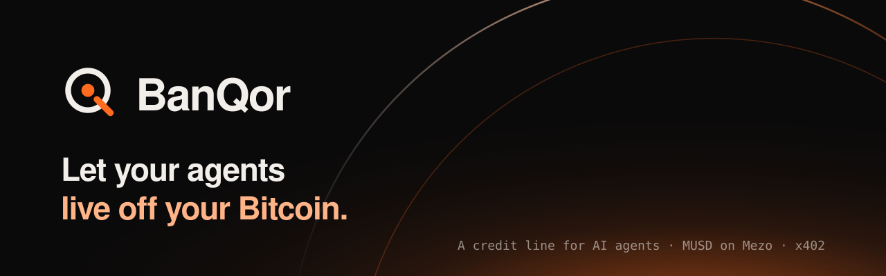

<p align="center"></p>

# BanQor: a Bitcoin-backed credit line for AI agents

[](https://getbanqor.vercel.app) [](https://explorer.test.mezo.org/address/0xcDa3Cb64aEd90C2A77981434d66AD3F3197fC791) [](#tests-and-scripts) [](https://repo.sourcify.dev/31611/0xcDa3Cb64aEd90C2A77981434d66AD3F3197fC791)

**Mezo Buildathon (AKINDO), Wave 1** · Track 2, Access & Distribution (primary) · Track 1, DeFi · Mezo troves, MUSD, x402

AI agents now pay per API call with x402, but someone has to keep their wallets topped up, and a BTC holder who wants to fund them has to sell Bitcoin first. BanQor turns a Mezo trove into a credit line for agents: your BTC stays locked as collateral, and each agent borrows MUSD against it just in time, inside limits the contract enforces. The agent spends that MUSD on any x402 API, settled on Mezo through the standard facilitator.

**Your agent gets an allowance. Your Bitcoin never leaves.**

| | |
|---|---|
| Live app | [getbanqor.vercel.app](https://getbanqor.vercel.app), and the [dashboard on the live demo vault](https://getbanqor.vercel.app/app.html#/overview?vault=0xcDa3Cb64aEd90C2A77981434d66AD3F3197fC791) (no wallet needed) |
| Live credit line | [Line opened](https://explorer.test.mezo.org/tx/0x380651df0a630a25902ac6cbf520f595f4988a6849c1e1f36eef0669e635fda5): 0.07 BTC locked, 2,001.80 MUSD trove debt, owned by the [vault contract](https://explorer.test.mezo.org/address/0xcDa3Cb64aEd90C2A77981434d66AD3F3197fC791), Mezo testnet, Oct 24, 2026 |
| Agent borrowing on its own | [This draw](https://explorer.test.mezo.org/tx/0x7fc61371d7e4f31a58c68a40c6958d0ee2aeb564f8c88d8ed156473bfa22bf5c): the vault was short, so it borrowed 6 MUSD from the trove inside the agent's `draw()` |
| Agent paying APIs | **152 x402 payments, 4.03 MUSD, settled on-chain in 27 minutes** by the [demo agent](https://explorer.test.mezo.org/address/0x60e149536aB20bBdBe4040c304Bd3387dBA4b26E): [first](https://explorer.test.mezo.org/tx/0x1937effb827faabc5170f07a396dbdc3b95b5f9958ed99c96696043c4e54dc8f), [last](https://explorer.test.mezo.org/tx/0xc6e317474e259495ee7c06d7252d24052cb5a3b306c7a3a863891c6d911540cf) |
| Cost | The agent pays **0 gas per API call** (the facilitator settles). A `draw()` from the vault's float is 106,299 gas; one that also borrows from the trove is 749,295 |
| Verified source | Factory and vault: [Sourcify exact match](#addresses) |
| Nothing simulated on the money path | Real Mezo trove, real MUSD, real x402 settlement through `facilitator.vativ.io`. [What is real and what is not](#what-is-real-and-what-is-not) |

## Judge fast path

Five minutes, no keys, nothing to install.

1. Open the [dashboard on the demo vault](https://getbanqor.vercel.app/app.html#/overview?vault=0xcDa3Cb64aEd90C2A77981434d66AD3F3197fC791). Every number is read live from Mezo: the trove's collateral ratio, debt, BTC price, the prices where agent draws stop and where liquidation starts, and both agents with their limits.
2. Go to **Agents** and press **Test** on `0x60e1…b26E`, then **Run checks** with 1 MUSD. The dashboard runs the vault's own `draw()` as that agent (an `eth_call`, nothing is sent) and shows the 10 checks passing.
3. Now try to break it. Type **1.5** and run again: blocked at check 6, `DrawTooLarge`. Pick the revoked agent `0xBd05…8389`: blocked at check 3, `AgentInactive`. The verdicts come from the live contract, not from the page.
4. Follow the evidence: the [agent's 152 payments](https://explorer.test.mezo.org/address/0x60e149536aB20bBdBe4040c304Bd3387dBA4b26E), the [draw that borrowed from the trove](https://explorer.test.mezo.org/tx/0x7fc61371d7e4f31a58c68a40c6958d0ee2aeb564f8c88d8ed156473bfa22bf5c), and the owner's [pause](https://explorer.test.mezo.org/tx/0x77493bc3f798e093a870fdd3be1390d995260f4a8b13677ca64637d46e561383) and [unpause](https://explorer.test.mezo.org/tx/0x0cecdd717447e12a3efaaf47d1db7b42d7b91b0b578293bd172d7bb51d5478f1).
5. Connect any wallet on Mezo testnet and open [**Open a line**](https://getbanqor.vercel.app/app.html#/open). Size a line and the summary prices it with Mezo's live fee, minimum debt, gas deposit and BTC price before you sign anything.

## The problem

An agent that pays per call needs money in its wallet at the moment it calls. Today that means one of two bad options:

- **Pre-fund a hot wallet.** Someone tops it up by hand, too much sits in a key that can leak, and when it runs dry the agent stops mid-task.
- **Sell Bitcoin to fund it.** BTC holders on Mezo give up the asset they want to keep.

Mezo already lets you borrow MUSD against BTC, and already has an x402 rail where sellers can paywall APIs. Nothing connects the two: there is no way to give an agent a **bounded, revocable allowance drawn from your Bitcoin**.

## How it works

```
 Owner's BTC ──deposit──▶ BanQorVault ──draw()──▶ Agent float ──x402 (exact, MUSD)──▶ Any paid API
                          owns a Mezo trove         small, capped     facilitator.vativ.io
                          enforces agent policy
                          guards the trove's ICR
```

1. **Open a line.** The owner deposits BTC. The vault opens a Mezo trove in its own name, and the minted MUSD stays in the vault.
2. **Set rules per agent:** a daily cap, a max float, a max single draw, an expiry, and an ICR floor for the trove (at least 150%, 200% by default).
3. **The agent spends.** When its float runs low, the SDK calls `draw()`. If the vault is short, it borrows more from the trove, but only while the trove stays at or above the floor.
4. **The agent pays APIs** with the standard x402 `exact` flow, using MUSD via Permit2 with EIP-2612 gas sponsoring.
5. **The owner stays in control:** pause, edit or revoke agents, repay, add or withdraw BTC, sweep, or close. If Mezo redeems or liquidates the trove, `claimCollateral()` recovers any surplus BTC. Anyone can call `rebalance()` when the trove gets close to its floor. It repays from idle MUSD only what brings the ICR back to floor + buffer, so it can't be used to drain the agents' float.

## Why a vault-owned trove, and not a funded hot wallet

| | Hot wallet you top up | Agent holding a trove | **BanQor vault** |
|---|---|---|---|
| Money at risk if the agent key leaks | Whatever you loaded | The whole trove | **The agent's float plus what's left of today's cap** |
| Who borrows against BTC | Nobody, you sell or pre-fund | The agent, with no limits | **The vault, only on a valid `draw()`** |
| Limits enforced by | Nothing | Nothing | **The contract, in a fixed order (10 checks)** |
| Stop everything | Move the funds | Not possible | **One `pause()` from the owner** |
| Protects the collateral | No | No | **No draw below the owner's ICR floor; Mezo liquidates only at 110%** |

The LLM or script driving the agent never decides how much it may spend. It can ask; the vault's checks decide.

## Judging criteria, mapped to evidence

| Criterion (weight) | Evidence |
|---|---|
| **Mezo Integration (30%)** | Each vault is the borrower of its own Mezo trove, through BorrowerOperations, TroveManager, HintHelpers, SortedTroves and PriceFeed ([interfaces](contracts/src/interfaces)). Agents spend MUSD over Mezo's x402 rail via the official `@x402/*` 2.16 SDKs and facilitator. The vault handles Mezo's rules directly: the 1,800 MUSD minimum debt, the 200 MUSD gas deposit, borrowing fees, insert hints, redemption surplus via `claimCollateral()`. |
| **Product & Business Viability (30%)** | Every dollar an agent spends is new MUSD borrowed against BTC, so agent volume is MUSD demand. It funds the buyer side of x402 on Mezo, where sellers can already charge. Integration is one line for agent developers (`createBanQorFetch`). |
| **Technical Implementation (20%)** | 123 tests: 78 contract unit, fuzz and invariant tests, 4 fork tests against the real Mezo contracts, and SDK, API, end-to-end and dashboard suites ([tests](#tests-and-scripts)). Reentrancy guards, checks-effects-interactions, no proxies. Live on testnet with verified source. |
| **User Experience (10%)** | A [live dashboard](https://getbanqor.vercel.app/app.html#/overview?vault=0xcDa3Cb64aEd90C2A77981434d66AD3F3197fC791) for owners: line health at a glance, before → after previews for every action, a three-step wizard to open a line, plain-language agent limits, a pause switch, and a "Test a draw" panel that asks the live contract. Works read-only for anyone, on desktop and phone. |
| **Submission Materials (10%)** | This README, the [landing page](https://getbanqor.vercel.app), on-chain evidence for every claim, and the design docs ([OVERVIEW](OVERVIEW.md), [PRD](PRD.md), [ARCHITECTURE](ARCHITECTURE.md), [PLAN](PLAN.md)). |

### Track 2, Access & Distribution (primary)

Tools, bots and interfaces for MUSD users. BanQor is all three: an SDK that turns any agent into an MUSD spender in one line, the agent scripts that run it, and an owner dashboard that makes a trove manageable by people who will never read a contract.

### Track 1, DeFi

Borrowing with MUSD. BanQor is a policy layer over Mezo's borrowing: just-in-time borrowing under per-agent caps, a collateral-ratio floor above Mezo's own, repayment from idle MUSD, and collateral recovery after redemption.

## What is real and what is not

| Real, on Mezo testnet | Simulated or local |
|---|---|
| The trove, its BTC collateral and MUSD debt | The breach demo's refused draws run as `eth_call`, so a refusal costs no gas. Its owner steps (setting a probe agent, revoking it, pausing, unpausing) are real transactions |
| Every `draw()`, including the one that borrowed from the trove | Local fork tests mock Mezo's PriceFeed with the live price, because its oracle precompile can't run on a fork |
| All 152 x402 payments, settled by `facilitator.vativ.io` | The demo API's data comes from CoinGecko and alternative.me, with a cached fallback |
| The deployed factory and vault, verified on Sourcify | Testnet BTC and MUSD have no market value |

During the live run, 6 of the 152 payments settled on-chain but the facilitator answered the API with a 402 anyway, so the agent got no data for those calls. The API now logs both sides of verify and settle to make this visible.

## Threat model

| Threat | What stops it |
|---|---|
| An agent key leaks | The attacker can take that agent's current float plus what's left of today's cap, until the owner pauses or revokes. An agent key can never call owner functions or touch the collateral |
| An agent asks for more than allowed | `draw()` checks, in order: paused, registered, active, expiry, amount > 0, max per draw, daily cap, max float, line open, ICR floor. The first failure reverts |
| Agents push the trove toward liquidation | No draw may leave the trove below the owner's floor (≥150%, default 200%), well above Mezo's 110% liquidation line. A falling BTC price can still lower the ratio; then draws stop on their own and the owner adds BTC or repays |
| Someone drains the float via `rebalance()` | `rebalance()` only runs below floor + buffer, and repays only what restores floor + buffer |
| Reentrancy through MUSD or BTC transfers | Every state-changing function is `nonReentrant`; `draw()` records the spend before any external call; MUSD moves through `SafeERC20` |
| Upgrade or admin abuse | No proxies, no upgradability, no admin over vaults. Mezo addresses are immutable per vault |
| Mezo redeems or liquidates the trove | `claimCollateral()` returns any surplus BTC to the owner; `closeLine()` resets the line |
| The dashboard is framed for clickjacking | `X-Frame-Options: DENY`, plus `nosniff` and a strict referrer policy |

## Repository

| Path | What |
|---|---|
| `contracts/` | Foundry project: `BanQorFactory`, `BanQorVault`, Mezo interfaces, unit, fuzz, invariant and fork tests |
| `packages/sdk` | `@banqor/sdk`: `createBanQorFetch()`, a vault client, typed errors, hints and preview math |
| `apps/api` | Demo paid API using the official `@x402/express` middleware (`/price` 0.01, `/funding` 0.02, `/sentiment` 0.05 MUSD, plus a free `/health`) |
| `apps/agent` | `setup`, `run` and `breach` scripts |
| `apps/dashboard` | Landing page (`index.html`) and owner dashboard (`app.html`: Overview, Agents, Activity, Open a line; Vite, React, wagmi) |
| `deployments/31611.json` | The single source of addresses for every package |
| `PRD.md`, `ARCHITECTURE.md`, `OVERVIEW.md`, `PLAN.md` | Product and design docs |

## Addresses

All addresses (the Mezo MUSD system and BanQor) live in [`deployments/31611.json`](deployments/31611.json), the single source every package reads.

| Contract (Mezo testnet) | Address | Source verified |
|---|---|---|
| BanQorFactory | [`0x036cEDfaA78eC84Ae52ecefe0d27D7D42Daac5ab`](https://explorer.test.mezo.org/address/0x036cEDfaA78eC84Ae52ecefe0d27D7D42Daac5ab) | [Sourcify, exact match](https://repo.sourcify.dev/31611/0x036cEDfaA78eC84Ae52ecefe0d27D7D42Daac5ab) |
| Demo BanQorVault (owns a live Mezo trove) | [`0xcDa3Cb64aEd90C2A77981434d66AD3F3197fC791`](https://explorer.test.mezo.org/address/0xcDa3Cb64aEd90C2A77981434d66AD3F3197fC791) | [Sourcify, exact match](https://repo.sourcify.dev/31611/0xcDa3Cb64aEd90C2A77981434d66AD3F3197fC791) |

| Demo wallet | Address |
|---|---|
| Owner | [`0xfcaadF018B4f734e632Ef15d2F547BB5BaCD7B57`](https://explorer.test.mezo.org/address/0xfcaadF018B4f734e632Ef15d2F547BB5BaCD7B57) |
| Agent | [`0x60e149536aB20bBdBe4040c304Bd3387dBA4b26E`](https://explorer.test.mezo.org/address/0x60e149536aB20bBdBe4040c304Bd3387dBA4b26E) |
| API payee | [`0x92a8f22c435124F203DF0639d5e0764ae98e68B3`](https://explorer.test.mezo.org/address/0x92a8f22c435124F203DF0639d5e0764ae98e68B3) |

Verification on the Mezo testnet explorer was submitted too, but the explorer's verification queue hasn't processed any contract since Oct 21, 2026. The Sourcify matches are exact, covering source, compiler settings and metadata.

## For agent developers

Replace `fetch` with one line:

```ts
import { createBanQorFetch } from "@banqor/sdk";

const fetchPaid = createBanQorFetch({
  agentKey: process.env.AGENT_KEY as `0x${string}`,
  vault: "0xYourVault",
  network: "eip155:31611",
  rpcUrl: "https://rpc.test.mezo.org",
  minFloat: "0.20",        // draw when the float falls below this
  topUp: "1.00",           // MUSD per draw
  maxPricePerCall: "0.10", // refuse anything pricier, before signing
  allowedPayees: ["0xApi…"],
  onEvent: (e) => console.log(e), // draw | payment | refused
});

const res = await fetchPaid("http://localhost:4021/price");
```

Refusals arrive as a `BanQorError` with a `code`: `Paused`, `DailyCapExceeded`, `FloatExceeded`, `DrawTooLarge`, `IcrTooLow`, `AgentExpired`, `NotAgent`, `PriceTooHigh`, `PayeeNotAllowed`, and so on.

## Tests and scripts

**123 tests, all passing** (run on Oct 25, 2026).

| Suite | Tests | Command | Covers |
|---|---|---|---|
| Contract unit, fuzz and invariant | 78 | `pnpm contracts:test` | Every function and custom error, the daily-cap and ICR-floor invariants, owner-only access, MUSD conservation, reentrancy |
| Contract fork | 4 | `pnpm contracts:test:fork` | The full flow against the real Mezo contracts on a testnet fork |
| SDK | 26 | `pnpm --filter @banqor/sdk test` | Error decoding, plus the vault client and `ensureFloat` on a local anvil fork of Mezo |
| API | 7 | `pnpm --filter @banqor/api test` | 402 requirements (exact, MUSD, amounts), data cache and fallback |
| End-to-end | 6 | `pnpm --filter @banqor/agent test` | Agent, SDK, demo API and vault on a Mezo fork: paid calls with automatic draws that borrow from the trove, price and payee guards, pause |
| Dashboard | 2 | `pnpm --filter @banqor/dashboard test` | Formatting helpers and chain config from the deployments file |

On a local fork, Mezo's PriceFeed can't run because it reads an oracle precompile. The tests fetch the live price from the real RPC and mock `fetchPrice()` with that value.

## Running it

Requirements: Node 22, pnpm 10, Foundry.

```bash
pnpm install
```

```bash
cp .env.example .env
```

Fill in `OWNER_KEY`, `AGENT_KEY` and `PAY_TO` in `.env`. Fund the owner with testnet BTC from https://faucet.test.mezo.org. A 1,800 MUSD line at about 300% ICR needs roughly 0.07 BTC.

```bash
pnpm contracts:test
```

```bash
pnpm contracts:test:fork
```

```bash
pnpm contracts:deploy
```

This deploys and verifies the factory, then records its address in `deployments/31611.json` once its code is confirmed on-chain.

```bash
pnpm build
```

```bash
pnpm agent:setup
```

```bash
pnpm api
```

In a second terminal:

```bash
pnpm agent:run
```

```bash
pnpm agent:breach
```

```bash
pnpm dashboard
```

The landing page is at http://localhost:5173 and the dashboard at http://localhost:5173/app.html. Connect the owner wallet to manage your line, or add `?vault=0x…` to any page (for example `app.html#/overview?vault=0x…`) to view a vault read-only.

### Deploying

To deploy the landing page and dashboard on Vercel, import the repo and set **Root Directory** to `apps/dashboard`. Everything else comes from `apps/dashboard/vercel.json`. No environment variables are needed, and none of the `.env` keys belong there.

## Honest limits

- **Unaudited, testnet only.** Do not use real funds.
- **Agents need a little BTC for gas** to call `draw()`. Paying APIs is gasless for them. A relayer that removes this is the first Wave 2 item.
- **Idle MUSD in the vault accrues interest** on the trove debt. `repay()` or `sweep()` it if your agents don't need it.
- **The breach demo's refusals are `eth_call`s**, not mined reverts. That is how the contract would answer, at no gas cost.
- **No CI yet.** Tests run locally with the commands above.

## Roadmap

| When | What |
|---|---|
| Wave 2 (Nov 2–15, 2026) | Zero-BTC agents (`drawWithSig` + relayer), a keeper that calls `rebalance()` and sends alerts, a Claude-driven research agent whose budget is the vault policy, auto-repay from agent revenue, spend analytics |
| Dec 2026 | Security review, then a mainnet beta |
| Q1 2027 | SDK integrations with x402 sellers on Mezo |

## License

[MIT](LICENSE) © 2026 Abdulsalam Hassan
